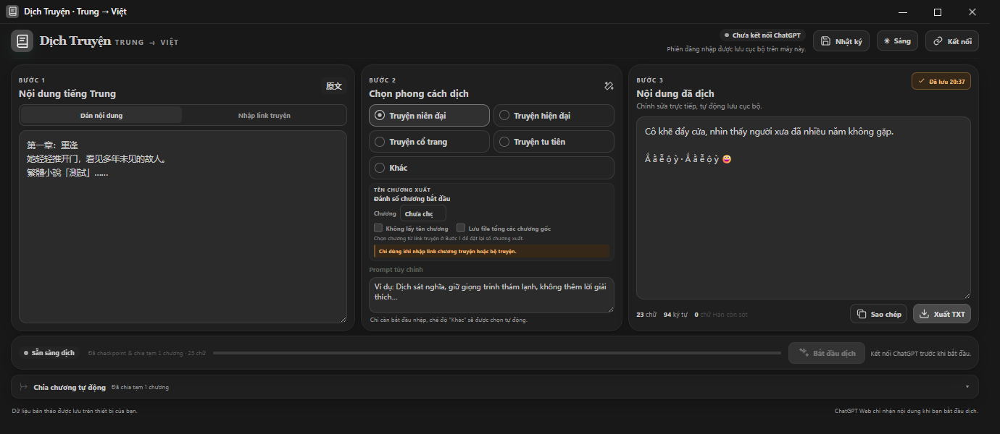

<div align="center">
  
  <h1>Tool Dịch Truyện · Trung → Việt</h1>
  <p><strong>Ứng dụng Windows thông minh hỗ trợ tải truyện, dịch bằng ChatGPT, Kimi, DeepSeek, Gemini Web, khóa tên mỏ neo Story Bible & NameLocker, tối ưu hóa RAM, khôi phục checkpoint và xuất bản dịch chuyên nghiệp.</strong></p>
  <p>
    
    
    
    
    
    
  </p>
</div>



> [!IMPORTANT]
> Tool điều khiển giao diện web của ChatGPT, Kimi, DeepSeek hoặc Gemini trong trình duyệt do ứng dụng quản lý; không gọi API tốn phí và không lưu trữ mật khẩu cá nhân. Người dùng tự đăng nhập và toàn quyền kiểm soát phiên làm việc.

## Tổng quan

Tool Dịch Truyện gom toàn bộ quy trình dịch truyện dài vào một ứng dụng desktop mạnh mẽ: nhập văn bản hoặc phân tích link truyện, xây dựng bối cảnh thực thể (**Story Bible**), khóa cứng tên nhân vật (**NameLocker** với mỏ neo `⟦...⟧`), dịch có checkpoint tự động, kiểm tra chất lượng bản dịch theo thời gian thực, xoay đoạn chat chống tràn RAM, chia chương và xuất file TXT hoàn chỉnh.

**Điều hướng:** [Tính năng chính](#tính-năng-chính) · [Công nghệ Story Bible & NameLocker](#công-nghệ-story-bible--namelocker-v2) · [Tối ưu hóa RAM & Xoay chat](#tối-ưu-hóa-hiệu-năng--xoay-đoạn-chat) · [Cài đặt phát triển](#cài-đặt-và-chạy-phát-triển) · [Cách sử dụng](#cách-sử-dụng) · [Đóng gói](#build-và-đóng-gói-windows)

## Tính năng chính

- **Đa nền tảng AI Web hàng đầu:** Hỗ trợ 4 chatbot thông minh: **ChatGPT**, **Kimi AI**, **DeepSeek AI**, và **Gemini AI**; tự động đảo bot cứu hộ và quản lý đa tài khoản.
- **Hệ thống Story Bible & NameLocker v2:** Khóa cứng tên nhân vật bằng mỏ neo kỹ thuật `⟦...⟧`. Đảm bảo tên riêng, biệt danh không bao giờ bị AI dịch sai lệch hoặc hallucinate.
- **Chuẩn hóa danh xưng Latinh cho nhân vật ngoại quốc:** Bắt buộc dùng chữ cái Latinh quốc tế chuẩn duy nhất (ví dụ: `Jelina`), triệt tiêu hoàn toàn lỗi "1 người 3 tên" hoặc âm Hán-Việt thô cứng.
- **Phân tách thông minh Tên rút gọn & Biệt danh cố định:** Tự động nhận diện và khóa riêng biệt tên gọi bỏ họ (`秀麗` -> `⟦Tú Lệ⟧`) và biệt danh thân mật (`剛子` -> `⟦Cương Tử⟧`), bảo tồn 100% sắc thái tự nhiên trong đối thoại.
- **Tối ưu hóa RAM & Xoay đoạn chat tự động:** Tự động mở chat mới theo chu kỳ vàng (10–15 đoạn ~ 110.000 ký tự), thu gọn DOM, giải phóng bộ nhớ RAM từ 8GB xuống dưới 400MB khi dịch bộ truyện dài hàng trăm chương.
- **Phím tắt ngầm `Ctrl + R` & Huy hiệu phiên bản:** Làm mới giao diện tức thì và hiển thị huy hiệu `v1.3.0` trực quan trên thanh tiêu đề.
- **Trình nhập nguồn truyện đa năng:** Hỗ trợ Huliwang, XSZJ/爱下电子书, TimoTXT, Novel543, Qingrenyouxi, Xbanxia kèm tiện ích mở rộng `Huli Browser Helper` giải mã font chữ chống cào trộm.
- **Khôi phục Checkpoint bền vững:** Tự động lưu trạng thái sau từng phân đoạn; khi xảy ra sự cố mạng hoặc tắt app, người dùng chỉ cần bấm "Tiếp tục" là chạy tiếp ngay.
- **Công cụ hậu kỳ chuyên nghiệp:** Tự động chia chương, đánh lại số chương, tùy chọn bỏ tên chương, xuất file TXT chương lẻ và file TXT tổng hợp hoàn chỉnh.

---

### Công nghệ Story Bible & NameLocker v2

Một trong những vấn đề nan giải nhất khi dịch tiểu thuyết dài tập bằng AI là hiện tượng nhân vật bị "đổi tên", "dịch sót", hoặc "một người có 3-4 tên gọi khác nhau":

```
[Bản nguồn tiếng Trung]               [Bản dịch tiếng Việt chuẩn]
李學剛 (Lý Học Cương)        ───►     ⟦Lý Học Cương⟧
剛子   (Biệt danh của Cương) ───►     ⟦Cương Tử⟧
吳秀麗 (Ngô Tú Lệ)           ───►     ⟦Ngô Tú Lệ⟧
秀麗   (Tên gọi bỏ họ)        ───►     ⟦Tú Lệ⟧
耶莲娜 / 耶莲卡 (Ngoại quốc)  ───►     ⟦Jelina⟧ (Latinh chuẩn duy nhất)
```

1. **Khóa mỏ neo `⟦...⟧`:** Toàn bộ tên riêng đã nhận diện được bọc trong cặp ngoặc mỏ neo trước khi chuyển vào Prompt. AI được lập trình tuyệt đối không can thiệp vào cụm từ bên trong mỏ neo.
2. **Khớp tiền tố dài nhất (Longest-Match Priority):** Tên 3 chữ (`吳秀麗`) luôn được khớp và khóa trước tên 2 chữ (`秀麗`), ngăn chặn hoàn toàn hiện tượng nuốt chữ hoặc đè chéo tên.
3. **Mở khóa tự nhiên (Natural Unlock):** Sau khi nhận bản dịch từ AI, hệ thống tự động tháo dỡ các ngoặc mỏ neo, tự động chèn khoảng cách biên từ chuẩn mực tiếng Việt.

---

### Tối ưu hóa hiệu năng & Xoay đoạn chat

Khi dịch truyện dài từ 50 đến hàng trăm chương trong cùng một phiên chat, cây cấu trúc DOM của trình duyệt Chrome/Edge bị phình to với hàng vạn thẻ KaTeX, Markdown, gây giật lag và đẩy mức chiếm dụng RAM lên tới 6GB – 8GB.

* **Chu kỳ xoay chat tối ưu (10 - 15 Segments):** Hệ thống tự động theo dõi tổng số ký tự tích lũy (~110.000 ký tự) và số phân đoạn. Khi đạt ngưỡng an toàn, Tool tự động mở một hội thoại mới tinh, truyền đầy đủ bối cảnh tóm tắt và mỏ neo sang đoạn chat mới.
* **Tiết kiệm tài nguyên:** Bộ nhớ RAM luôn được duy trì ổn định dưới 400MB, tốc độ phản hồi của ChatGPT luôn ở mức cao nhất, không bị hiện tượng treo đơ trình duyệt.

---

### Nhập Huliwang bằng trình duyệt mặc định

Huliwang có thể từ chối trình duyệt tự động dù không hiện CAPTCHA. Bản đầy đủ kèm thư mục
`Huli Browser Helper` nằm ngay cạnh `ToolDichTruyen.exe`, cho phép tool đọc trang trong chính Cốc Cốc/Chrome/Edge và profile bạn dùng hằng
ngày. Tiện ích không đọc cookie, lịch sử hay mật khẩu, không dùng Playwright/CDP và không tự bấm
CAPTCHA hoặc Turnstile.

1. Khi Huliwang báo Cloudflare trong tab `Nhập link truyện`, bấm `Mở thư mục tiện ích`. Thư mục được mở là
   `Huli Browser Helper`, ngay cạnh file `ToolDichTruyen.exe`.
2. Mở `README-VI.md` trong thư mục đó và tải tiện ích đã giải nén một lần vào trình duyệt mặc định: `coccoc://extensions`,
   `chrome://extensions` hoặc `edge://extensions`.
3. Quay lại tool, bấm `Kết nối trình duyệt mặc định`. Trang ghép nối cục bộ `127.0.0.1` mở trong
   đúng profile thường; kết nối xong tool tự phân tích lại link.
4. Giữ tab Huliwang mở trong lúc tải chương. Nếu website hiện kiểm tra tương tác, hoàn tất bằng tay;
   tiện ích chỉ đọc lại DOM, không reload liên tục và không tự thao tác bước xác minh.

Chrome/Edge trên Windows không cho ứng dụng portable tự cài tiện ích cục bộ một cách im lặng, nên
bước tải tiện ích đã giải nén cần được người dùng xác nhận một lần.

## Lưu ý quan trọng về chatbot Web

Tool điều khiển giao diện web của ChatGPT, Kimi và DeepSeek bằng trình duyệt, không gọi API dịch trực tiếp.

- Người dùng phải tự đăng nhập chatbot đã chọn trong cửa sổ trình duyệt được tool mở. Tool không tự điền, lưu hoặc vượt qua mật khẩu, CAPTCHA hay xác thực hai bước.
- Phiên đăng nhập được giữ trong một profile trình duyệt cục bộ dành riêng cho ứng dụng.
- Giao diện, thuộc tính DOM và luồng phản hồi của từng chatbot có thể thay đổi bất kỳ lúc nào. Khi đó automation hoặc selector có thể ngừng hoạt động và cần được cập nhật.
- A/B test giao diện, CAPTCHA, giới hạn tài khoản, giới hạn tần suất, lỗi mạng hoặc thay đổi chính sách dịch vụ có thể làm tác vụ thất bại.
- Hãy sử dụng tài khoản và nội dung phù hợp với điều khoản của dịch vụ liên quan.

## Yêu cầu

### Để chạy bản phát triển

- Windows 10/11.
- Node.js `>= 22`.
- `pnpm` tương thích với lockfile của dự án.
- Microsoft Edge hoặc Google Chrome đã cài trên máy.
- Tài khoản của ít nhất một chatbot ChatGPT, Kimi, DeepSeek hoặc Gemini có thể đăng nhập bằng trình duyệt.

### Để dùng tính năng đặt tên chương

- Gemini API key từ Google AI Studio hoặc một nguồn cấu hình Gemini tương thích.
- Đây là tính năng tùy chọn; dịch và chia chương thông thường không phụ thuộc Gemini.

## Cài đặt và chạy phát triển

Yêu cầu Node.js 22+ và pnpm 11.16.0. Repository không chứa cookie, profile trình duyệt, draft, checkpoint, bản dịch hay khóa API. Không chép dữ liệu trong `%APPDATA%\tool-dich-truyen` vào source/GitHub.

Tại thư mục gốc dự án:

```powershell
pnpm install --frozen-lockfile
pnpm dev
```

Nếu lockfile đang được chủ động cập nhật trong quá trình phát triển, người duy trì có thể dùng `pnpm install`; trước khi phát hành nên quay lại quy trình cài đặt cố định bằng lockfile.

Để chạy bản build đã tạo trước đó:

```powershell
pnpm start
```

Lệnh `start` chỉ phù hợp sau khi output cần thiết đã tồn tại.

## Cách sử dụng

### 1. Chọn và kết nối chatbot

1. Chọn ChatGPT, Kimi AI, DeepSeek AI hoặc Gemini AI trên thanh chatbot rồi bấm `Kết nối`.
2. Nếu trạng thái yêu cầu đăng nhập, đăng nhập thủ công trong cửa sổ trình duyệt vừa mở.
3. Hoàn tất CAPTCHA hoặc xác thực hai bước nếu dịch vụ yêu cầu.
4. Quay lại ứng dụng và bấm `Kiểm tra kết nối` nếu trạng thái chưa tự cập nhật.
5. Chọn nhóm chatbot được phép dùng cho tiến trình (mặc định cả bốn) và chỉ bắt đầu dịch khi chatbot hiện tại đã kết nối.

Gemini Web dùng profile trình duyệt riêng (`gemini-browser-profile`) và phiên đăng nhập Google độc lập với ba chatbot còn lại. Đăng nhập một lần trong cửa sổ do ứng dụng mở, sau đó phiên được giữ lại trên máy.

Đã đo bằng chạy thật: chương ngắn khoảng 13 giây, chương 1.700 chữ Hán khoảng 72 giây. Gemini có giai đoạn "suy nghĩ" vài giây trước khi trả lời; tool chờ đúng cờ hoàn tất của trang nên không cắt sớm phản hồi.

**Model dùng để dịch:** tool tự chuyển về bản **Pro mới nhất** trước mỗi lượt gửi (bỏ qua Flash, Flash-Lite và chế độ "Tư duy mở rộng" vì chế độ đó không tự nhận là Pro).

Nếu tài khoản không có model Pro nào, tool **dừng và báo lỗi** kèm danh sách model nó nhìn thấy, thay vì âm thầm dịch bằng model khác. Bảng chọn không mở được hoặc chọn xong mà Gemini không đổi model cũng báo lỗi tương tự. Đây là chủ ý: model khác nhau cho ra cách dùng từ và mức lọc an toàn khác nhau, nên dịch nhầm model còn tệ hơn là báo lỗi.

**Chống lặp đoạn đầu:** với chương dài, Gemini đôi khi bỏ dở đoạn mở đầu rồi viết lại từ đầu trong cùng một phản hồi. Tool phát hiện tiêu đề chương bị lặp sát đầu văn bản và chỉ giữ lại bản viết hoàn chỉnh.

**Khi Gemini hết hạn mức:** Gemini khoá các model cao và ghi mốc đặt lại hạn mức ngay trong bảng chọn. Tool đọc mốc đó và xử lý như sau:

- Nếu tiến trình còn AI khác trong nhóm đã chọn (ChatGPT / Kimi / DeepSeek), tool **tự chuyển sang AI đó** và dịch tiếp, không đốt thêm lượt thử trên tài khoản đã hết hạn mức.
- Nếu tiến trình chỉ có Gemini, tool **tạm dừng** và hiển thị thông báo dạng *"Gemini đã hết hạn mức dùng model cao (3.1 Pro). Hạn mức sẽ được đặt lại vào 15:13 20 thg 9. Hãy thử lại sau thời điểm đó…"*. Các đoạn đã dịch được giữ nguyên; bấm `Tiếp tục` sau mốc đó là chạy tiếp, không mất công.

### Quản lý nhiều tài khoản

Nút `Tài khoản (n)` trên thanh công cụ mở danh sách tài khoản đã lưu của bot đang chọn:

Thanh công cụ **không còn nút `Kết nối`** — nút `Tài khoản` nằm ở vị trí đó. Chọn chatbot chỉ đổi lựa chọn và không mở trình duyệt; chỉ nút `Thêm tài khoản` mới mở trình duyệt. Sau khi đăng nhập, hãy **đóng cửa sổ đó**, tool tự đọc và lưu tài khoản. Nếu chưa có tài khoản mà bấm `Bắt đầu dịch`, tool sẽ nhắc thêm tài khoản và tự mở bảng này.

- Mỗi dòng hiển thị tên, email hoặc gói, và trạng thái hạn mức (`Còn hạn mức` / `Hết hạn mức tới 15:13 20/09` / `Chưa dùng`). Ô nhỏ phía trên là số tài khoản của từng bot.
- Bấm nút dấu tick để dùng tài khoản đó cho lượt dịch tiếp theo.
- `Thêm tài khoản` mở trình duyệt để bạn đăng nhập; sau khi đăng nhập, bấm `Kiểm tra kết nối` để tool tự đọc và lưu tài khoản đó. Gemini đọc được email, ChatGPT đọc được tên và gói; Kimi và DeepSeek không hiển thị tài khoản trong trang nên bạn tự đặt tên.
- Nút hình thùng rác xoá tài khoản khỏi danh sách. Profile của tài khoản đó được để lại và sẽ được dọn ở bước sau.
- `Dọn rác` chỉ xoá cache của mọi profile trình duyệt — **không xoá tài khoản và không làm mất phiên đăng nhập**.

Thứ tự xoay vòng khi hết hạn mức: tài khoản 1 → 2 → 3, **không quay lại tài khoản đã lỗi**. Hết cả danh sách thì tool chuyển sang chatbot khác nếu tiến trình có chọn, còn nếu chỉ có một bot thì tạm dừng kèm mốc đặt lại hạn mức. Mỗi tài khoản chỉ tiêu tốn đúng một lượt thử cho mỗi đoạn.

Gemini dùng chung một profile cho nhiều tài khoản (Google cho đăng nhập nhiều tài khoản trong cùng trình duyệt). ChatGPT, Kimi và DeepSeek mỗi tài khoản một profile riêng vì các trang đó chỉ giữ một phiên cho mỗi profile.

**Chat Gemini được nhận diện bằng dấu sở hữu, không bằng URL:** Google đã ngừng đưa ID hội thoại vào địa chỉ trang, nên tool dùng chính dấu ẩn nó gắn vào prompt để biết chat nào là của mình. Hai hệ quả cần biết:

- Tool **không tự xoá** chat Gemini sau khi dịch; các chat do tool tạo sẽ nằm lại trong lịch sử Gemini và bạn tự xoá nếu muốn.
- Nếu bạn tắt app giữa chừng rồi mở lại, tool sẽ **mở chat mới và gửi lại prompt gốc** thay vì quay về đúng chat cũ. Các đoạn đã dịch vẫn được giữ trong checkpoint.

Không mở đồng thời nhiều phiên Tool dịch truyện dùng chung profile trình duyệt.

### 2. Nhập nội dung và chọn prompt

1. Dán nội dung nguồn vào ô `Nội dung tiếng Trung`.
2. Chọn một trong năm chế độ:
   - `Truyện niên đại`: dùng prompt tại `resources/prompts/nien-dai.txt`.
   - `Truyện hiện đại`: dùng prompt tại `resources/prompts/hien-dai.txt`.
   - `Truyện cổ trang`: dùng prompt tại `resources/prompts/co-trang.txt`.
   - `Truyện tu tiên`: dùng prompt tại `resources/prompts/tu-tien.txt`.
   - `Khác`: dùng prompt người dùng nhập.
3. Khi bắt đầu gõ vào ô prompt tùy chỉnh, giao diện tự chọn chế độ `Khác`.

Bốn prompt mặc định được đọc dưới dạng UTF-8 khi ứng dụng chạy và được đóng kèm vào `resources` khi package.

### 3. Dịch và xử lý lỗi

1. Bấm `Bắt đầu dịch`.
2. Theo dõi số đoạn đã hoàn tất và trạng thái hiện tại.
3. Có thể `Tạm dừng`, `Tiếp tục` hoặc `Hủy` tác vụ.
4. Sau mỗi đoạn hợp lệ, checkpoint được lưu ngay, phần đã dịch được ghép vào ô `Nội dung đã dịch` và preview chia chương cập nhật song song trong worker riêng.
5. Khi một đoạn không vượt qua kiểm tra sau số lần thử cho phép, dùng nút `Tiếp tục từ đoạn lỗi` của đúng đoạn đó; các đoạn đã hoàn tất vẫn được giữ nguyên.
6. Kết quả hợp lệ được ghép vào ô `Nội dung đã dịch`; người dùng có thể sửa trực tiếp trước khi xuất.

Trong lúc tiến trình chạy, nhóm chatbot được khóa. Khi tiến trình lỗi, cả bốn lựa chọn chatbot được mở để người dùng chọn bot cứu đoạn. Bot ngoài nhóm chỉ chạy một lượt cho đúng đoạn lỗi, không tự retry, rồi tiến trình quay về nhóm chatbot ban đầu.

Việc sửa nội dung nguồn sau khi tác vụ đã bắt đầu không thay đổi snapshot nguồn của tác vụ đang chạy.

### 4. Kiểm tra và xuất bản dịch

- Chỉ số `chữ Hán còn sót` giúp phát hiện nhanh ký tự Trung chưa được dịch.
- Bản nháp nguồn, output, prompt tùy chỉnh và cấu hình chia chương được tự động lưu cục bộ.
- Dùng `Sao chép` để đưa bản dịch vào clipboard hoặc `Xuất TXT` để chọn nơi lưu tệp.
- Luôn đọc lại bản dịch trước khi xuất bản hoặc sử dụng tiếp.

### 5. Chia chương

Phần `Chia chương tự động` nằm dưới ô bản dịch.

1. Chọn số chữ/chương; mặc định là `800` và 750 là ngưỡng ưu tiên khi có thể.
2. Nhập chương bắt đầu, tiền tố và hậu tố nếu cần.
3. Chọn ngôn ngữ dùng để đếm chữ.
4. Bật `Nhận diện tiêu đề có sẵn` nếu nội dung đã có các dòng như `Chương 12: ...`.
5. Bật `Tô đỏ chữ Hán` để kiểm tra ký tự còn sót; tắt chế độ này khi cần sửa nội dung preview.
6. Sửa tên hoặc nội dung từng chương trong preview, sau đó sao chép hoặc xuất TXT.

Preview chỉ cắt tại ranh giới đoạn xuống dòng, không cắt giữa từ, câu hoặc lời thoại. Một đoạn dài hơn mục tiêu được giữ nguyên; vì vậy số chữ/chương có thể vượt khoảng mục tiêu. Preview là dữ liệu biên tập riêng. Sửa preview không ghi đè ô `Nội dung đã dịch`; nếu output hoặc cấu hình chia thay đổi, preview có thể được tạo lại.

### 6. Đặt tên chương bằng Gemini

1. Trong thanh công cụ chia chương, bấm `Cấu hình Gemini`.
2. Nhập model và API key, rồi bấm `Lưu cấu hình`.
3. Bấm `Đặt tên bằng Gemini` sau khi đã có danh sách chương.
4. Kiểm tra và sửa các tên gợi ý trước khi xuất.

Ứng dụng chỉ gửi trích đoạn đầu của mỗi chương tới Gemini khi người dùng chủ động bấm đặt tên. API key được xử lý ở main process; trên Windows, ứng dụng cố gắng mã hóa khóa bằng cơ chế bảo mật hệ điều hành. Có thể dùng biến môi trường thay vì lưu khóa trong giao diện.

## Biến môi trường

| Biến | Mục đích |
|---|---|
| `CHATGPT_BROWSER_EXECUTABLE` | Đường dẫn tuyệt đối tới `msedge.exe` hoặc `chrome.exe` nếu ứng dụng không tự tìm thấy trình duyệt. |
| `GEMINI_API_KEY` | Gemini API key dùng cho đặt tên chương. |
| `GOOGLE_API_KEY` | Tên biến dự phòng cho Gemini API key. |
| `GEMINI_MODEL` | Model Gemini mặc định nếu chưa lưu model trong cài đặt. |
| `CHATGPT_BASE_URL` | Ghi đè URL ChatGPT cho môi trường kiểm thử/phát triển; không nên đổi trong sử dụng thông thường. |
| `GEMINI_BASE_URL` | Ghi đè URL Gemini Web cho môi trường kiểm thử/phát triển; không nên đổi trong sử dụng thông thường. |
| `GEMINI_BROWSER_EXECUTABLE` | Đường dẫn tuyệt đối tới `msedge.exe` hoặc `chrome.exe` riêng cho phiên Gemini nếu cần. |
| `TOOL_DICH_TRUYEN_USER_DATA` | Ghi đè thư mục dữ liệu người dùng cho test cô lập. |

Ví dụ chỉ định Chrome trong PowerShell cho phiên terminal hiện tại:

```powershell
$env:CHATGPT_BROWSER_EXECUTABLE = 'C:\Program Files\Google\Chrome\Application\chrome.exe'
pnpm dev
```

Không commit API key, profile trình duyệt, draft hoặc dữ liệu người dùng vào Git.

## Kiểm thử

### Kiểm tra kiểu TypeScript

```powershell
pnpm typecheck
```

Có thể chạy riêng từng phía:

```powershell
pnpm typecheck:node
pnpm typecheck:web
```

### Test tự động

```powershell
pnpm test
```

Các nhóm test hiện được tổ chức tại:

- `tests/unit`: parser, đếm/ngôn ngữ, chia chương, chunk nguồn, prompt và validator.
- `tests/integration`: persistence, prompt loader, Gemini service, ChatGPT adapter và runner dịch với dependency được kiểm soát/mocked.
- `tests/renderer`: component UI và cầu nối `window.storyTool` được mock.

Chạy coverage:

```powershell
pnpm test:coverage
```

Chạy Electron smoke test:

```powershell
pnpm test:e2e
```

Smoke test build ứng dụng, mở Electron với thư mục user-data tạm, kiểm tra preload bridge, nhập dữ liệu mẫu, thử UI chia chương và lưu screenshot vào `test-results`. Test này không xác minh đăng nhập hoặc dịch thật qua website chatbot.

Không ghi nhận lệnh nào là `pass` chỉ dựa vào tài liệu này. Điền môi trường, kết quả, artifact và lỗi thực tế vào [docs/TEST_REPORT.md](docs/TEST_REPORT.md).

## Build và đóng gói Windows

Build TypeScript và Electron bundles:

```powershell
pnpm build
```

Nếu thành công, output trung gian được tạo trong `out`.

Đóng gói NSIS installer và portable executable:

```powershell
pnpm package:win
```

CI chỉ chạy typecheck, test không-live và production build. Các phép thử live cần phiên đăng nhập và thao tác mạng phải được chạy thủ công trên profile kiểm thử riêng.

Theo cấu hình hiện tại, artifact dự kiến nằm trong `release`. Sau khi đóng gói phải kiểm tra thực tế cả installer và portable trên một máy Windows sạch trước khi phát hành. Không coi thư mục hoặc tên script cấu hình là bằng chứng package đã thành công.

## Cấu trúc dự án

```text
src/
├── core/        # Logic thuần: parser, splitter, validator, chunk và prompt
├── main/        # Electron main, ChatGPT browser automation, persistence, Gemini
├── preload/     # Cầu nối IPC window.storyTool
├── renderer/    # React UI
└── shared/      # Type dùng chung
resources/
├── prompts/     # Bốn prompt phong cách đóng kèm ứng dụng
└── huli-browser-helper/ # Tiện ích trình duyệt cho các nguồn cần profile thường
tests/
├── unit/
├── integration/
├── renderer/
└── e2e/
```

## Xử lý sự cố

### Không tìm thấy Edge hoặc Chrome

- Cài Microsoft Edge hoặc Google Chrome.
- Hoặc đặt `CHATGPT_BROWSER_EXECUTABLE` tới executable hợp lệ.
- Đóng những phiên Tool dịch truyện khác đang giữ profile trình duyệt rồi thử lại.

### Luôn hiện “Chờ đăng nhập ChatGPT”

- Hoàn tất đăng nhập trong cửa sổ trình duyệt do ứng dụng mở, không phải một cửa sổ trình duyệt khác.
- Xử lý CAPTCHA/2FA nếu có.
- Quay lại ứng dụng và bấm `Kiểm tra kết nối`.
- Kiểm tra mạng và thử mở trực tiếp `https://chatgpt.com/`.

### Đã đăng nhập nhưng tool không tìm thấy ô nhập

ChatGPT có thể vừa thay đổi DOM hoặc đang chạy một biến thể giao diện chưa được selector hỗ trợ. Ghi lại phiên bản ứng dụng, screenshot, URL/trạng thái nhìn thấy và mở issue để cập nhật `src/main/chatgpt/selectors.ts` cùng adapter. Không dùng selector quá rộng để “sửa nhanh” vì có thể gửi nội dung nhầm vị trí.

### Gemini báo chưa cấu hình hoặc lỗi khóa

- Kiểm tra API key/model trong phần `Cấu hình Gemini`.
- Hoặc đặt `GEMINI_API_KEY` trước khi khởi động ứng dụng.
- Xác minh quota và quyền dùng model của tài khoản Google.
- Dịch và chia chương vẫn dùng được khi bỏ qua chức năng Gemini.

### Luôn hiện “Chờ đăng nhập Gemini AI” khi dịch bằng Gemini

- Đăng nhập Google trong đúng cửa sổ Gemini do ứng dụng mở, không phải một cửa sổ trình duyệt khác.
- Hoàn tất xác minh hai bước nếu tài khoản yêu cầu, rồi quay lại ứng dụng và bấm `Kiểm tra kết nối`.
- Gemini Web có thể đổi DOM thường xuyên hơn ba chatbot còn lại. Nếu ô nhập hiện diện nhưng tool không gửi được, ghi lại screenshot và cập nhật `GEMINI_SELECTORS` trong `src/main/chatgpt/selectors.ts`.
- Không dùng chung profile với phiên ChatGPT/Kimi/DeepSeek; mỗi chatbot có thư mục profile riêng.

### Bản dịch còn chữ Hán

- Xem đoạn lỗi tương ứng và dùng `Thử lại` nếu tác vụ đã đánh dấu lỗi.
- Nếu chỉnh thủ công, dùng bộ đếm và chế độ tô đỏ trong preview chia chương để kiểm tra lại.
- Bộ kiểm tra tự động không thay thế việc biên tập của con người.

## Dữ liệu và quyền riêng tư

- Draft, cấu hình và profile đăng nhập của từng chatbot (ChatGPT, Kimi, DeepSeek, Gemini) được lưu riêng trong thư mục dữ liệu người dùng của ứng dụng trên máy.
- Nội dung nguồn được gửi tới website chatbot đang được chọn khi bắt đầu dịch.
- Trích đoạn chương được gửi tới Gemini chỉ khi dùng tính năng đặt tên AI.
- Tệp TXT chỉ được ghi tới vị trí người dùng chọn.
- Trước khi chia sẻ log hoặc screenshot, hãy xóa nội dung truyện, token, API key và thông tin tài khoản.

## Giấy phép

Dự án hiện khai báo `UNLICENSED` và dành cho sử dụng nội bộ/cục bộ cho đến khi có chính sách cấp phép khác.
